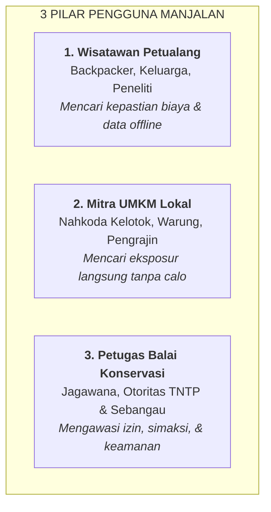

# MANJALAN — DOKUMEN KOMPREHENSIF PITCHING & PRESENTASI

> **Tagline:** *"Rencanakan Saat Online, Tetap Siap Saat Offline."*  
> **Kategori:** Travel Readiness Platform / Smart Ecotourism / Offline-First PWA  
> **Destinasi Percontohan:** Kalimantan Tengah (Taman Nasional Tanjung Puting & Taman Nasional Sebangau)  
> **Format Dokumen:** Bahan Lengkap Penyusunan Presentasi / Slide Generator (Notebook / Marp / python-pptx / Gamma / Quarto)

---

## DAFTAR ISI

1. [BAGIAN 1: Ringkasan Eksekutif (Executive Summary)](#bagian-1-ringkasan-eksekutif-executive-summary)
2. [BAGIAN 2: Latar Belakang & Analisis Konteks Geografis](#bagian-2-latar-belakang--analisis-konteks-geografis)
3. [BAGIAN 3: Rumusan Masalah (5 Pain Points Kritis)](#bagian-3-rumusan-masalah-5-pain-points-kritis)
4. [BAGIAN 4: Visi, Misi, & Positioning Produk](#bagian-4-visi-misi--positioning-produk)
5. [BAGIAN 5: Profil Pengguna & Stakeholder (User Persona)](#bagian-5-profil-pengguna--stakeholder-user-persona)
6. [BAGIAN 6: Bedah Fitur Utama & Solusi Inovatif](#bagian-6-bedah-fitur-utama--solusi-inovatif)
7. [BAGIAN 7: Inovasi Fitur Khusus Manjalan](#bagian-7-inovasi-fitur-khusus-manjalan)
8. [BAGIAN 8: Arsitektur Teknologi & Rekayasa Sistem](#bagian-8-arsitektur-teknologi--rekayasa-sistem)
9. [BAGIAN 9: Model Bisnis & Dampak Sosial-Ekonomi](#bagian-9-model-bisnis--dampak-sosial-ekonomi)
10. [BAGIAN 10: Analisis Kompetitor & Keunggulan Kompetitif](#bagian-10-analisis-kompetitor--keunggulan-kompetitif)
11. [BAGIAN 11: Panduan Skenario Demo Manual di Web (Slide Demo)](#bagian-11-panduan-skenario-demo-manual-di-web-slide-demo)
12. [BAGIAN 12: Roadmap Pengembangan & Skalabilitas Nasional](#bagian-12-roadmap-pengembangan--skalabilitas-nasional)
13. [BAGIAN 13: Cetak Biru Slide Demi Slide (Slide-by-Slide Blueprint)](#bagian-13-cetak-biru-slide-demi-slide-slide-by-slide-blueprint)

---

## BAGIAN 1: Ringkasan Eksekutif (Executive Summary)

**MANJALAN** adalah platform kesiapan perjalanan wisata (*Travel Readiness Platform*) pertama di Indonesia yang dirancang khusus untuk destinasi ekowisata pedalaman Kalimantan Tengah, khususnya kawasan konservasi Taman Nasional Tanjung Puting dan Taman Nasional Sebangau.

Berbeda dari Online Travel Agent (OTA) konvensional yang hanya berfokus pada transaksi komersial pemesanan tiket pesawat atau kamar hotel perkotaan, MANJALAN berfokus pada **kesiapan hulu-ke-hilir** wisatawan:
1. **Fase Perencanaan di Kota (Online):** Membantu wisatawan membedah dan menghitung estimasi biaya riil perjalanan susur sungai (sewa perahu kelotok kayu ulin, perizinan simaksi balai, kru juru masak, dan dana darurat tunai).
2. **Fase Persiapan Digital:** Mengunduh seluruh rute, panduan pos konservasi, kontak darurat maritim radio VHF Saluran 16, dan direktori UMKM lokal ke dalam memori peramban (*IndexedDB*) dalam paket sangat ringan (~0.2 MB).
3. **Fase Eksekusi di Lapangan (Offline / Blankspot):** Saat kapal kelotok berlayar masuk ke kedalaman rimba tanpa sinyal seluler, wisatawan tetap memiliki akses penuh terhadap data perjalanan tanpa membutuhkan kuota internet.
4. **Fase Pemberdayaan Ekonomi Lokal:** Menghubungkan wisatawan langsung dengan nahkoda kelotok lokal, warung apung, dan pengrajin anyaman Dayak tanpa perantara calo, dilengkapi fitur ulasan Google Maps terintegrasi.

---

## BAGIAN 2: Latar Belakang & Analisis Konteks Geografis

### 1. Karakteristik Ekowisata Kalimantan Tengah
- **Taman Nasional Tanjung Puting (TNTP):**
  - Luas: 415.040 hektar.
  - Habitat alami lebih dari 6.000 individu orangutan liar (*Pongo pygmaeus*), bekantan, burung enggang, dan flora endemik.
  - Pusat rehabilitasi orangutan tertua di dunia yang dipelopori oleh Dr. Birute Galdikas (Camp Leakey sejak 1971).
  - Moda transportasi utama: Perahu kayu tradisional bertingkat dua (*Kelotok*) yang berfungsi sekaligus sebagai penginapan terapung selama 3 hari 2 malam (3D2N) atau 4 hari 3 malam (4D3N) menyusuri Sungai Sekonyer.
- **Taman Nasional Sebangau:**
  - Luas: 568.000 hektar ekosistem rawa gambut tropis alami air hitam (*peat blackwater ecosystem*).
  - Terkenal dengan navigasi susur Sungai Koran dan ekowisata Danau Kereng Bangkirai di Palangka Raya & Katingan.
- **Taman Wisata Alam (TWA) Bukit Tangkiling:**
  - Kawasan perbukitan batu granit purba dan pusat konservasi kerajinan tradisional getah nyatu khas Dayak Kahayan.

### 2. Paradoks Pariwisata Pedalaman Borneo
Meskipun popularitas ekowisata Tanjung Puting dan Sebangau sangat tinggi di kalangan wisatawan mancanegara dan domestik, terdapat **kesenjangan digital dan geografis (geographical gap)** yang sangat tajam:
- **Kondisi Tanpa Sinyal (Blankspot Area):** Begitu perahu kelotok melewati Pos Muara Sekonyer menuju pos feeding Tanjung Harapan, Pondok Tanggui, dan Camp Leakey, jaringan seluler 4G/LTE mati total. Seluruh aplikasi berbasis cloud konvensional tidak dapat digunakan.
- **Ketiadaan Fasilitas Perbankan Lapangan:** Tidak ada mesin ATM atau kantor perbankan di sepanjang jalur sungai. Jarak ke ATM terdekat di Pelabuhan Kumai mencapai puluhan kilometer.
- **Keterbatasan Pasokan Listrik:** Di kapal kelotok, listrik hanya mengandalkan generator genset berisik di malam hari atau panel surya (*solar panel*) terbatas.

### 3. Peluang Transformasi Digital yang Ramah Lapangan (*Locally Adapted*)
Pariwisata di daerah 3T (Tertinggal, Terdepan, Terluar) dan kawasan konservasi membutuhkan teknologi yang tidak menuntut konektivitas terus-menerus (*high bandwidth*), melainkan teknologi yang **hemat data, hemat baterai, dan beroperasi secara lokal di ponsel pengguna (Offline-First)**.

---

## BAGIAN 3: Rumusan Masalah (5 Pain Points Kritis)

Melalui wawancara dengan wisatawan, nahkoda kelotok di Dermaga Kumai, dan petugas balai konservasi, kami merumuskan 5 masalah mendasar:

```
+-----------------------------------------------------------------------------------+
|                        5 MASALAH KRITIS DI LAPANGAN                               |
+-----------------------------------------------------------------------------------+
|  1. INFORMASI TERCECER       | Rute, tarif, simaksi di PDF lama & sosmed usang     |
|  2. ANGGARAN TAK TERPREDIKSI | Kejutan biaya tak terduga (BBM sungai, tips kru)   |
|  3. DILEMA METODE BAYAR      | Wisatawan bingung kapan bisa QRIS & kapan tunai     |
|  4. BLANKSPOT DI HULU        | Aplikasi OTA & Google Maps mati saat sinyal padam   |
|  5. UMKM KALAH BERSAING      | Nahkoda lokal & warung tersingkir oleh agen calo    |
+-----------------------------------------------------------------------------------+
```

### 1. Information Fragmentation (Informasi Tercecer & Tidak Terstandarisasi)
Wisatawan yang hendak merencanakan perjalanan ke Tanjung Puting atau Sebangau kesulitan menemukan panduan terpadu. Dokumen izin simaksi (*Surat Izin Masuk Kawasan Konservasi*), jadwal pemberian makan orangutan, dan rute navigasi dermaga tersebar di blog pribadi yang sudah bertahun-tahun tidak diperbarui, akun Instagram tidak resmi, atau dokumen PDF yang susah dibaca di smartphone.

### 2. Budget Uncertainty (Ketidakpastian Biaya Riil Perjalanan)
Banyak wisatawan mengalami pembengkakan biaya (*budget shock*) karena struktur tarif ekowisata sungai sangat berbeda dari wisata kota. Biaya tidak hanya mencakup sewa kamar, tetapi mencakup:
- Sewa kapal kelotok kayu ulin (badan kapal, nahkoda, juru mudi).
- Pasokan logistik makanan segar dan koki kapal (*cook*).
- BBM solar perahu untuk susur sungai hulu.
- Tarif Simaksi Balai Konservasi per hari per orang (berbeda antara WNI dan WNA).
- Pemandu lokal berlisensi HPI (Himpunan Pramuwisata Indonesia).
- Dana cadangan tunai darurat.

### 3. Payment Dilemma (Dilema Metode Pembayaran Tunai vs Non-Tunai)
Di era digital, banyak wisatawan muda hanya membawa saldo e-wallet atau kartu debit. Namun di pedalaman sungai, listrik dan jaringan internet tidak tersedia, sehingga mesin EDC dan QRIS tidak dapat memproses transaksi. Wisatawan sering panik saat hendak membeli makanan di warung apung atau membeli kerajinan rotan karena tidak membawa uang tunai fisik. Sebaliknya, saat di pelabuhan kota, beberapa wisatawan tidak tahu bahwa pembayaran digital QRIS sudah tersedia.

### 4. The Blankspot Blackout (Lumpuhnya Aplikasi Populer Saat Dibutuhkan)
Google Maps, Traveloka, Tiket.com, dan TripAdvisor sangat bergantung pada koneksi internet terus-menerus. Ketika perahu berlayar jauh ke pedalaman hutan hujan tropis, aplikasi-aplikasi ini menampilkan galat *offline*, peta tidak dapat dimuat, dan informasi kontak tidak dapat diakses. Wisatawan kehilangan pegangan informasi navigasi dan protokol keselamatan.

### 5. Marginalisasi Pelaku UMKM Lokal
Pelaku usaha lokal di sekitar dermaga (pemilik perahu kelotok keluarga, warung kuliner tradisional ikan patin bakar, pengrajin anyaman Dayak Kandui) memiliki keterbatasan literasi pemasaran digital. Akibatnya, sebagian besar pesanan dikuasai oleh agen perantara (*middleman* / calo) yang memotong komisi besar, sementara pemilik kapal dan kru lokal hanya menerima upah minim.

---

## BAGIAN 4: Visi, Misi, & Positioning Produk

### Visi
Menjadi platform kesiapan perjalanan wisata (*Travel Readiness Platform*) nomor satu di Indonesia yang mendemokratisasi akses informasi ekowisata pedalaman, memberdayakan UMKM lokal, dan mendukung pariwisata berkelanjutan ramah konservasi.

### Misi
1. **Mempersiapkan Wisatawan:** Menyediakan kalkulator anggaran transparan dan akurat berbasis tarif riil lapangan.
2. **Menjamin Aksesibilitas:** Menyediakan teknologi paket informasi offline yang dapat diakses di mana pun tanpa internet.
3. **Mendorong Inklusi Keuangan:** Memetakan kesiapan metode pembayaran (QRIS, Transfer, dan Tunai) secara realistis.
4. **Memberdayakan Komunitas Lokal:** Memberikan akses promosi digital langsung bagi pelaku UMKM dan nahkoda lokal.
5. **Mendukung Konservasi Alam:** Mengintegrasikan aturan resmi balai konservasi dan nomor radio darurat maritim ke dalam genggaman wisatawan.

### Positioning Matrix (Manjalan vs Entitas Lain)
- **Bukan OTA (Online Travel Agent):** Kami tidak bersaing menjual tiket pesawat komersial atau kamar hotel bintang lima.
- **Bukan Booking Engine Monopolistik:** Kami tidak mengenakan potongan komisi per transaksi yang membebani pedagang kecil.
- **Bukan Aplikasi Konten Sosial:** Kami tidak menyajikan feed sosial yang bising, melainkan data esensial yang siap pakai (*actionable readiness data*).

```
                      FOKUS EKOWISATA / PEDALAMAN
                                   ▲
                                   │       ★ MANJALAN
                                   │   (Offline-First + Readiness)
                                   │
      OFFLINE ─────────────────────┼───────────────────── ONLINE
      RELIANT                      │                      RELIANT
                                   │   OTA Konvensional
                                   │   (Traveloka / Tiket.com)
                                   │
                                   ▼
                      FOKUS PARIWISATA KOTA BESAR
```

---

## BAGIAN 5: Profil Pengguna & Stakeholder (User Persona)



### 1. Persona Wisatawan (Primary User)
- **Nama Representatif:** Arya & Rina (Pasangan Traveler / Mahasiswa / Peneliti, Usia 22-38 Tahun).
- **Karakteristik:** Gemar petualangan alam terbuka, terbiasa menggunakan smartphone, sensitif terhadap transparansi anggaran, peduli kelestarian lingkungan (*eco-conscious*).
- **Tujuan Utama:** Menikmati safari orangutan di Tanjung Puting tanpa rasa cemas kehabisan uang tunai, tanpa tersesat, dan tanpa tertipu harga calo.
- **Kebutuhan:** Kalkulator estimasi biaya riil, panduan rute yang tersimpan di HP saat mode pesawat, dan kontak radio darurat.

### 2. Persona Pelaku UMKM Lokal (Secondary User)
- **Nama Representatif:** Pak Joko (Nahkoda Perahu Kelotok Berkah Sekonyer) & Ibu Ratna (Pemilik Warung Apung Patin).
- **Karakteristik:** Masyarakat lokal pesisir Sungai Sekonyer/Kumai, memiliki perahu kelotok berizin balai, terbiasa komunikasi menggunakan WhatsApp, minim pengetahuan teknis pembuatan website.
- **Tujuan Utama:** Mendapatkan pesanan sewa kapal atau kunjungan makan siang langsung dari wisatawan tanpa dipotong biaya komisi tinggi oleh perantara.
- **Kebutuhan:** Profil usaha digital sederhana yang menampilkan nomor WhatsApp langsung, foto cover kapal/warung, tautan ulasan Google Maps, dan status kesiapan pembayaran (QRIS/Tunai).

### 3. Persona Petugas Balai Konservasi & Otoritas (Government / Regulatory User)
- **Nama Representatif:** Pak Rahmat Subekti (Pengawas Lapangan Balai TNTP Pos Kumai).
- **Karakteristik:** Aparatur pengelola kawasan konservasi, bertugas memverifikasi kelayakan perahu wisata, memantau keselamatan susur sungai, dan memastikan kepatuhan perizinan simaksi.
- **Tujuan Utama:** Mengetahui perahu kelotok mana saja yang beroperasi resmi dan memastikan keselamatan wisatawan di sepanjang jalur sungai.
- **Kebutuhan:** Dashboard supervisi untuk memvalidasi (ACC) permohonan kemitraan baru, mengelola akun mitra resmi, dan menyebarkan protokol keselamatan radio maritim VHF.

---

## BAGIAN 6: Bedah Fitur Utama & Solusi Inovatif

### Fitur 1: Smart Budget Planner (Kalkulator Anggaran Interaktif)
- **Lokasi Akses:** `/budget`
- **Fungsi:** Menghitung estimasi biaya riil perjalanan wisata secara transparan dan detail.
- **Algoritma Input:**
  - *Titik Keberangkatan:* Pangkalan Bun (bandara terdekat), Palangka Raya, Jakarta, Surabaya, atau Banjarmasin.
  - *Jumlah Peserta:* 1 hingga 20 orang rombongan.
  - *Durasi Ekspedisi:* Pilihan hari dan malam (misal 3D2N atau 4D3N).
  - *Gaya Perjalanan:* 
    - **Hemat:** Berbagi perahu (*sharing kelotok*), konsumsi standar rumahan, fasilitas esensial.
    - **Standar:** Sewa perahu pribadi keluarga, koki berpengalaman, kasur kelambu bersih, pemandu HPI.
    - **Eksklusif:** Perahu kelotok VIP dek ganda dengan pendingin ruangan/solar panel, dokumentasi, kuliner sungai premium.
- **Output Biaya:**
  1. Sewa Kapal Kelotok & Nahkoda (termasuk bahan bakar solar sungai).
  2. Tiket Masuk & Perizinan Simaksi Balai TNTP (dihitung per orang per hari).
  3. Logistik Makanan Segar & Upah Koki Kapal.
  4. Pemandu Rimba Berlisensi HPI & Awak Kapal Lokal Dayak.
  5. Rekomendasi Cadangan Dana Tunai Darurat.
  6. Total Biaya Rombongan & Estimasi Biaya Per Orang.
- **Interaksi Pengguna:** Hasil kalkulasi dapat disimpan ke memori lokal HP atau dibagikan langsung ke grup WhatsApp keluarga/rombongan.

### Fitur 2: Offline Travel Pack (Paket Panduan Tanpa Internet)
- **Lokasi Akses:** `/pack` dan `/destinasi/[id]`
- **Fungsi:** Mengunduh bundel data penting perjalanan ke dalam memori peramban (*IndexedDB*) sehingga dapat dibuka kapan saja meski ponsel dalam Mode Pesawat.
- **Konten yang Disimpan:**
  - Profil lengkap destinasi dan titik koordinat GPS dermaga.
  - Peta rute susur sungai dan jadwal pemberian makan orangutan di Pos Tanjung Harapan (15.00), Pondok Tanggui (09.00), dan Camp Leakey (14.00).
  - Lembar Darurat SOS: Frekuensi Radio Maritim VHF Saluran 16 (156.8 MHz), nomor radio darurat kelotok, nomor satelit Balai Konservasi, dan Puskesmas Kumai.
  - Salinan daftar UMKM terverifikasi dan rincian kontak darurat nahkoda.
- **Indikator Kesiapan (Readiness Banner):** Menampilkan status kapasitas memori yang terpakai (misal: 0.2 MB) dan progress bar paket yang telah diunduh.
- **Simulator Offline:** Tombol pengujian di `/pack` untuk mensimulasikan penggunaan aplikasi tanpa internet secara visual.

### Fitur 3: Payment & Signal Readiness Transparency
- **Lokasi Akses:** Terintegrasi di kartu destinasi, direktori UMKM, dan detail tempat.
- **Fungsi:** Memberikan panduan metode pembayaran yang jujur dan pemetaan sinyal seluler per titik perjalanan.
- **Label Kesiapan Pembayaran:**
  - 🟢 **QRIS Terverifikasi:** Didukung nama merchant NMID resmi (aktif di area dermaga Kumai atau pos utama).
  - 🔵 **Transfer Bank:** Pilihan nomor rekening (Bank Kalteng, BRI, Mandiri) untuk pembayaran deposit saat di hotel.
  - 🟡 **Uang Tunai Diperlukan:** Peringatan tegas bagi lokasi blankspot sungai hulu bahwa transaksi hanya dapat dilakukan dengan uang fisik.
- **Label Kesiapan Sinyal:**
  - *Sinyal 4G Stabil* (Pelabuhan Panglima Utar Kumai).
  - *Sinyal Edge di Muara, Blankspot di Hulu* (Sungai Sekonyer).
  - *Blankspot Total* (Kedalaman Hutan Rawa Gambut Sebangau).

---

## BAGIAN 7: Inovasi Fitur Khusus Manjalan

### Inovasi 1: Badge Review Google Maps & Foto Cover Tempat
- **Latar Belakang Fitur:** Wisatawan sering ragu dengan kredibilitas armada kapal kelotok atau warung apung jika hanya melihat teks deskripsi. Mereka membutuhkan validasi sosial (*social proof*).
- **Mekanisme Fitur:**
  - Setiap mitra yang mendaftar **wajib menyertakan tautan Google Maps** tempat/usahanya.
  - Pada tampilan kartu direktori wisatawan (`/umkm`), terpasang badge hijau mencolok: `Review Google Maps` dengan ikon peta dan panah eksternal.
  - Saat diklik, peramban langsung membuka ulasan, rating bintang, dan foto asli dari Google Maps di tab baru (`target="_blank"`) tanpa mengganggu alur navigasi di aplikasi.
  - Dilengkapi fitur upload foto cover tempat dari file lokal HP atau tautan gambar web dengan pratinjau thumbnail instan.

### Inovasi 2: Tata Kelola Akun Mitra 1-ke-Banyak (1-to-Many Relationship)
- **Latar Belakang Fitur:** Di dunia nyata, seorang pemilik usaha lokal sering memiliki lebih dari satu armada kapal kelotok (misalnya: *Kelotok Berkah 01* dan *Kelotok Berkah 02*) atau memiliki cabang warung apung di dermaga lain.
- **Mekanisme Fitur:**
  - 1 Akun Mitra (berdasarkan Nomor WhatsApp) dapat menaungi **banyak tempat/layanan sekaligus**.
  - Mitra dapat mengajukan tempat kedua dan seterusnya melalui tombol `+ Ajukan Tempat Baru` di ruang kerja `/mitra`.
  - Tempat baru akan diverifikasi oleh Petugas Balai sebelum aktif otomatis di bawah akun yang sama.

### Inovasi 3: Keamanan Sandi Sekali Lihat (*One-Time View*) & WhatsApp Dispatch
- **Latar Belakang Fitur:** Menjaga privasi akun mitra dan memastikan kredensial login tersampaikan langsung ke tangan pemilik usaha secara aman.
- **Mekanisme Fitur:**
  - Saat pendaftaran mitra masuk ke antrean Petugas Balai di URL rahasia `/login`, kata sandi disamarkan (`••••••••`).
  - Ketika Petugas menekan tombol `ACC & Buat Akun`, modal dialog kredensial terbuka **hanya sekali saja**.
  - Modal ini menyediakan tombol hijau `Kirim Kredensial via WhatsApp` yang langsung membuka aplikasi WhatsApp dengan pesan resmi yang telah terformat rapi (berisi link masuk, ID No. WA, dan kata sandi alfanumerik).
  - Jika mitra lupa kata sandi di kemudian hari, Petugas dapat melakukan reset password yang kembali menghasilkan kata sandi baru sekali lihat untuk dikirimkan via WhatsApp.
  - **Prinsip Otoritas Berimbang:** Petugas Balai memiliki wewenang mengelola akun (CRUD), namun **dilarang keras mengubah data tempat mitra secara sepihak** (*Strict Read-Only pada tempat*).

---

## BAGIAN 8: Arsitektur Teknologi & Rekayasa Sistem

```
+-----------------------------------------------------------------------------------+
|                        ARSITEKTUR HIBRIDA MANJALAN                                |
+-----------------------------------------------------------------------------------+
|  CLIENT / BROWSER RUNTIME                                                         |
|  ┌─────────────────────────────────┐   ┌────────────────────────────────────────┐ |
|  │ Next.js 14 App Shell (React 18) │   │ W3C IndexedDB Cache Engine ('idb')    │ |
|  │ TypeScript + Tailwind CSS       │   │ Kapasitas >50 MB (Rute, SOS, UMKM)     │ |
|  └────────────────┬────────────────┘   └───────────────────▲────────────────────┘ |
|                   │                                        │                      |
|                   ▼                                        │ Fallback saat Offline|
|  ┌─────────────────────────────────────────────────────────┴────────────────────┐ |
|  │ Fail-Safe Data Switcher (Online ➔ Cloud / Offline ➔ Local IndexedDB)          │ |
|  └────────────────┬─────────────────────────────────────────────────────────────┘ |
|                   │                                                               |
|  SERVER & CLOUD (Saat Online)                                                     |
|  ┌────────────────▼────────────────┐   ┌────────────────────────────────────────┐ |
|  │ Next.js Server Route Handlers   │   │ Supabase PostgreSQL Cloud DB           │ |
|  │ Rate Limiting + Zod Validations │◄──┤ Row-Level Security (RLS) + Edge Funcs  │ |
|  └─────────────────────────────────┘   └────────────────────────────────────────┘ |
+-----------------------------------------------------------------------------------+
```

### 1. Lapisan Antarmuka & Performa (Frontend)
- **Framework:** Next.js 14 dengan arsitektur App Router dan React 18 Server/Client Components.
- **Bahasa:** TypeScript ketat (*Strict Type Checking*) tanpa `any` liar pada model data inti.
- **Styling:** Tailwind CSS dengan palet warna bernuansa alam tropis (*Deep Blue, Emerald Green, Amber*).
- **Performa Ringan:** Ukuran *First Load JS* seluruh aplikasi hanya **~114 kB**, menjamin kecepatan rendering di ponsel berspesifikasi rendah dan jaringan 3G/Edge dermaga.

### 2. Lapisan Penyimpanan Offline (Client-Side Storage)
- **Teknologi:** W3C IndexedDB yang diakses melalui pembungkus promise modern `idb`.
- **Kelebihan dibanding LocalStorage:** Mampu menampung data hingga ratusan megabyte secara terstruktur tanpa memblokir thread utama JavaScript (*non-blocking asynchronous I/O*).
- **Skema Object Store:** `destinations`, `umkm`, `emergencyContacts`, `travelPacks`, dan `budgets`.

### 3. Lapisan Backend & Keamanan (Backend & Cloud)
- **Database Cloud:** Supabase PostgreSQL dengan proteksi Row Level Security (RLS).
- **Validasi Data:** Seluruh input form divalidasi di sisi klien dan server menggunakan skema pustaka **Zod**.
- **Perlindungan Keamanan:** Dilengkapi fungsi pembersih tag HTML (*sanitization*) untuk mencegah serangan Cross-Site Scripting (XSS) dan pembatasan frekuensi permintaan (*In-memory Sliding Window Rate Limiting*).

---

## BAGIAN 9: Model Bisnis & Dampak Sosial-Ekonomi

### 1. Model Keberlanjutan Finansial (B2B2G Revenue Model)
MANJALAN tidak membebankan biaya unduh kepada wisatawan dan tidak memotong komisi transaksi tunai dari pelaku UMKM. Pendapatan berkelanjutan diperoleh melalui:
1. **Langganan Kemitraan Komersial (Verified Listing B2B):** Biaya verifikasi tahunan bagi operator kapal kelotok skala besar dan biro perjalanan untuk mendapatkan lencana resmi (*Verified Partner Badge*) dan prioritas algoritma pencarian.
2. **Kemitraan Balai Otoritas & Pemerintah Daerah (B2G Analytics Dashboard):** Penyediaan dasbor analitik pariwisata terpadu bagi Dinas Pariwisata dan Balai Konservasi TNTP untuk memantau tren pergerakan wisatawan, kepatuhan keselamatan kapal, dan persebaran transaksi non-tunai.
3. **Sponsorship Ekowisata Berkelanjutan:** Kemitraan dengan brand perlengkapan petualangan luar ruang (*outdoor gear*), perusahaan logistik ramah lingkungan, dan provider telekomunikasi satelit dalam bentuk kurasi Travel Pack bermerek.

### 2. Dampak Ekonomi Langsung bagi Komunitas Lokal (Direct Economic Multiplier)
- **100% Retensi Pendapatan Lokal:** Seluruh uang yang dibayarkan wisatawan untuk sewa kapal, makanan ikan patin bakar, dan kerajinan rotan langsung masuk ke dompet warga lokal tanpa potongan fee 15-25% seperti pada OTA konvensional.
- **Pemberdayaan Perempuan Dayak:** Mengangkat kerajinan anyaman purun dan rotan karya pengrajin perempuan Desa Sekonyer agar dikenal langsung oleh wisatawan.
- **Inklusi Finansial Bertahap:** Menjadi jembatan edukasi digitalisasi perbankan bagi pelaku usaha tradisional pedalaman melalui pendampingan pendaftaran QRIS.

---

## BAGIAN 10: Analisis Kompetitor & Keunggulan Kompetitif

```
+-----------------------------------+--------------------+---------------+--------------------+-------------------+
|       PARAMETER EVALUASI          |  OTA KONVENSIONAL  |  GOOGLE MAPS  |  MEDIA SOSIAL      |     MANJALAN      |
|                                   | (Traveloka/Tiket)  |               |  (Instagram/TikTok)| (Travel Readiness)|
+-----------------------------------+--------------------+---------------+--------------------+-------------------+
| Akses Offline di Blankspot Rimba  |  ❌ Gagal Total    | ⚠️ Terbatas   |  ❌ Tidak Bisa     | ✅ 100% Siap      |
| Smart Budget Ekowisata & Kelotok  |  ❌ Tidak Ada      | ❌ Tidak Ada  |  ❌ Tidak Ada      | ✅ Otomatis       |
| Transparansi QRIS vs Uang Tunai   |  ❌ Tidak Ada      | ❌ Tidak Ada  |  ❌ Tidak Ada      | ✅ Terverifikasi  |
| Direktori UMKM Pedalaman & Maps   |  ❌ Hanya Hotel    | ⚠️ Rawan Duplikat| ⚠️ Tercecer       | ✅ Terverifikasi  |
| Protokol Radio Darurat (VHF 16)   |  ❌ Tidak Ada      | ❌ Tidak Ada  |  ❌ Tidak Ada      | ✅ Terintegrasi   |
| Supervisi Balai Konservasi (ACC)  |  ❌ Tidak Ada      | ❌ Tidak Ada  |  ❌ Tidak Ada      | ✅ Terhubung Balai|
+-----------------------------------+--------------------+---------------+--------------------+-------------------+
```

### Keunggulan Kompetitif Utama Manjalan (Competitive Moat):
1. **Offline-First by Design:** Aplikasi dibangun dari awal dengan arsitektur tahan blankspot, bukan aplikasi online yang dipaksa offline.
2. **Konteks Hiper-Lokal:** Memahami seluk-beluk ekowisata perahu kelotok kayu ulin, perizinan simaksi balai, dan dinamika arus Sungai Sekonyer yang tidak dipahami oleh korporasi OTA Jakarta.
3. **Kemitraan Erat dengan Otoritas Lapangan:** Mengintegrasikan peran pengawasan petugas Balai Konservasi secara seimbang tanpa merugikan kemandirian UMKM.

---

## BAGIAN 11: Panduan Skenario Demo Manual di Web (Slide Demo)

Ketika presentasi mencapai **Slide 13 (LIVE DEMO PRODUK)**, presenter tidak perlu menampilkan rekaman video atau mockup statis. Beralihlah ke tab peramban web dan lakukan **5 langkah pengujian langsung** berikut:

```
+-----------------------------------------------------------------------------------+
|                    PANDUAN LANGKAH DEMO PRODUK DI DEPAN JURI                      |
+-----------------------------------------------------------------------------------+
|  LANGKAH 1: Beranda & Unduh Travel Pack Destinasi (TN Tanjung Puting)             |
|  LANGKAH 2: Uji Coba Mode Pesawat / Offline di /pack                              |
|  LANGKAH 3: Simulasi Anggaran di Smart Budget Planner (/budget)                   |
|  LANGKAH 4: Direktori UMKM & Buka Badge Review Google Maps (/umkm)                |
|  LANGKAH 5: Pengajuan Kemitraan Baru (/mitra) & Verifikasi ACC Petugas (/login)   |
+-----------------------------------------------------------------------------------+
```

### Langkah 1: Eksplorasi Beranda & Unduh Travel Pack (`/`)
1. Buka halaman utama [http://localhost:3000](http://localhost:3000).
2. Tunjukkan antarmuka bersih bertema petualangan dengan status *Siap Offline*.
3. Klik kartu destinasi **Taman Nasional Tanjung Puting**.
4. Klik tombol hijau **"Unduh Travel Pack"**.
5. Tunjukkan kepada dewan juri notifikasi sukses dan bagaimana data langsung tersimpan ke IndexedDB di memori peramban.

### Langkah 2: Uji Coba Mode Pesawat / Tanpa Koneksi (`/pack`)
1. Buka menu navigasi bawah **Travel Pack** (`/pack`).
2. Aktifkan tombol sakelar **"Simulasi Mode Pesawat / Offline"** (atau putuskan koneksi WiFi laptop secara nyata).
3. Tunjukkan kepada juri: Aplikasi tetap dapat dibuka dengan lancar! Peta rute pos Tanjung Harapan, Pondok Tanggui, Camp Leakey, dan frekuensi **Radio Maritim VHF Saluran 16** tetap tampil utuh tanpa koneksi internet.

### Langkah 3: Simulasi Anggaran di Smart Budget Planner (`/budget`)
1. Buka menu **Budget** (`/budget`).
2. Pilih titik asal: *Jakarta*.
3. Atur stepper: *4 Orang Peserta*, durasi *3 Hari 2 Malam*, gaya perjalanan *Standar*.
4. Tunjukkan rincian pos biaya yang otomatis terhitung: Sewa Kelotok 2 Dek, Izin Simaksi Balai, Logistik Makan, Juru Masak, Pemandu HPI, dan Cadangan Uang Tunai.
5. Tekan tombol bagikan estimasi ke WhatsApp untuk menunjukkan kemudahan koordinasi rombongan.

### Langkah 4: Direktori UMKM & Validasi Review Google Maps (`/umkm`)
1. Buka menu **UMKM** (`/umkm`).
2. Tunjukkan kartu usaha lokal seperti *Kelotok Wisata Berkah Sekonyer* dan *Warung Apung Berkah*.
3. Klik tombol badge hijau **"Review Google Maps"**.
4. Buktikan bahwa tab baru Google Maps terbuka secara langsung, membuktikan bahwa wisatawan dapat membaca ulasan dan rating asli sebelum memutuskan untuk singgah.
5. Klik kartu untuk membuka modal detail dan tunjukkan transparansi kesiapan QRIS vs Uang Tunai.

### Langkah 5: Alur Kemitraan Baru & Persetujuan Petugas Balai (`/mitra` & `/login`)
1. Buka menu **Mitra** (`/mitra`), pilih tab *Ajukan Kemitraan Baru*.
2. Klik tombol kuning simulasi: **"Isi Simulasi UMKM"** (form otomatis terisi nama usaha, nomor WA, link Google Maps, foto cover, dan password).
3. Kirim formulir, lalu tunjukkan dialog konfirmasi kredensial.
4. Buka tab baru ke URL pengawasan petugas: `http://localhost:3000/login`.
5. Masuk dengan akun Petugas: ID `PETUGAS-01`, PIN `992024`.
6. Tunjukkan permohonan baru yang masuk di tab *Antrean Pengajuan Mitra*. Sorot bahwa kata sandi disembunyikan (`••••••••`) demi privasi.
7. Klik tombol hijau **"ACC & Buat Akun"**.
8. Tunjukkan modal pop-up kredensial sekali lihat (*One-Time View*) lengkap dengan tombol hijau otomatis untuk mengirimkan rincian akun ke WhatsApp mitra!

---

## BAGIAN 12: Roadmap Pengembangan & Skalabilitas Nasional

```mermaid
timeline
    title ROADMAP STRATEGIS MANJALAN (2026 - 2028)
    section Fase 1 : Q4 2026
        Validasi Inti MVP : Kotawaringin Barat (TNTP) & Palangka Raya (Sebangau)
        Onboarding Komunitas : 50+ Nahkoda Kelotok & Warung Sungai
        Uji Coba IndexedDB : Pengujian sinyal blankspot Sungai Sekonyer
    section Fase 2 : 2027
        Ekspansi Kalteng : Katingan, Gunung Mas, & Murung Raya
        Fitur Lingkungan : Integrasi sensor debit air sungai & cuaca
        Kemitraan Formal : MoU Dinas Pariwisata & Balai Konservasi
    section Fase 3 : 2027-2028
        Skalabilitas 3T : Replikasi ke Raja Ampat, Derawan, & Komodo
        Infrastruktur Offline : Pemasangan Kiosk Offline Docking di dermaga
        Smart Conservation Pass : Tiket konservasi digital terintegrasi
```

### 1. Fase 1: Validasi Inti Lapangan (Q4 2026 — Tahap Saat Ini)
- Fokus pada koridor utama: Pelabuhan Kumai, Sungai Sekonyer, Taman Nasional Tanjung Puting, dan Dermaga Kereng Bangkirai Sebangau.
- Onboarding 50 mitra perahu kelotok dan warung logistik sungai.
- Pengujian ketahanan IndexedDB di lapangan bersinyal nol (*dead-zone testing*).

### 2. Fase 2: Ekspansi Regional Kalimantan Tengah (2027)
- Memperluas cakupan ke Danau Gambut Bulat Katingan, Puruk Cahu Murung Raya, dan Riam Jeram Gunung Mas.
- Integrasi informasi pasang surut air sungai dan jadwal penyeberangan fery lokal.
- Kemitraan resmi dengan Dinas Kebudayaan & Pariwisata Provinsi Kalimantan Tengah.

### 3. Fase 3: Skalabilitas Nasional Kawasan Konservasi 3T (2027–2028)
- Replikasi model *Travel Readiness* ke destinasi kepulauan dan pedalaman nasional yang memiliki masalah blankspot serupa: Kepulauan Derawan, Labuan Bajo pedalaman, Taman Nasional Komodo, dan Raja Ampat.
- Pemasangan anjungan luring (*Offline Kiosk Docking Station*) berbasis WiFi lokal di dermaga-dermaga terpencil untuk sinkronisasi data instan bagi wisatawan tanpa kuota internet.

---

## BAGIAN 13: Cetak Biru Slide Demi Slide (Slide-by-Slide Blueprint)

Gunakan cetak biru di bawah ini sebagai teks sumber untuk diolah langsung ke notebook pembuatan presentasi (Marp, python-pptx, Quarto, atau AI Slide Maker):

---

### SLIDE 1
- **Judul Slide:** MANJALAN — Travel Readiness Platform
- **Subjudul:** Rencanakan Saat Online, Tetap Siap Saat Offline
- **Kategori:** Ideathon & Startup Pitching / Smart Ecotourism
- **Fokus Area:** Ekowisata Kalimantan Tengah (TN Tanjung Puting & TN Sebangau)
- **Poin Kunci:**
  - Platform kesiapan perjalanan wisata pertama berbasis Offline-First PWA di Indonesia.
  - Menghubungkan persiapan di perkotaan dengan eksekusi nyata di pedalaman rimba tanpa sinyal.
- **Catatan Pembicara (Speaker Notes):**  
  *"Selamat pagi Dewan Juri yang terhormat. Kami dari tim MANJALAN mempersembahkan Travel Readiness Platform pertama di Indonesia untuk ekowisata Kalimantan Tengah. Dengan filosofi 'Rencanakan Saat Online, Tetap Siap Saat Offline', Manjalan hadir menjawab tantangan nyata para petualang dan UMKM lokal di kawasan konservasi minim sinyal internet."*

---

### SLIDE 2
- **Judul Slide:** Konteks & Potensi Ekowisata Kalimantan Tengah
- **Subjudul:** Surga Konservasi Dunia dengan Tantangan Geografis Nyata
- **Poin Kunci:**
  - **TN Tanjung Puting:** Rumah bagi 6.000+ orangutan liar, wisata kelotok kayu ulin 3D2N menyusuri Sungai Sekonyer.
  - **TN Sebangau:** Laboratorium rawa gambut purba air hitam seluas 568.000 hektar.
  - **Paradoks Lapangan:** Minat petualang sangat tinggi, namun mayoritas wisatawan datang tanpa persiapan matang (*under-prepared*), mengalami kejutan biaya, dan buta informasi metode pembayaran di sungai.
- **Catatan Pembicara (Speaker Notes):**  
  *"Kalimantan Tengah memiliki magnet wisata kelas dunia. Namun berwisata ke pedalaman Borneo sangat unik: wisatawan menginap berhari-hari di perahu kelotok menyusuri sungai. Di sini timbul paradoks: turis bersemangat tetapi minim persiapan praktis. Mereka tidak tahu tarif kapal yang wajar, tidak tahu apakah warung apung menerima QRIS, dan begitu perahu melaju ke hulu, sinyal internet padam total."*

---

### SLIDE 3
- **Judul Slide:** 5 Masalah Kritis Wisatawan & Komunitas Lokal
- **Subjudul:** Mengapa Perjalanan ke Pedalaman Sering Mengalami Hambatan?
- **Poin Kunci:**
  1. *Informasi Tercecer:* Data rute, simaksi, dan aturan konservasi terpecah di PDF usang dan media sosial.
  2. *Ketidakpastian Biaya:* Struktur biaya kelotok, juru masak, dan bahan bakar sungai sulit diprediksi.
  3. *Dilema Pembayaran:* Kebingungan kapan QRIS dapat dipindai dan kapan uang tunai fisik mutlak diperlukan.
  4. *Blankspot di Hulu:* Aplikasi OTA konvensional dan Google Maps lumpuh total saat sinyal seluler padam.
  5. *UMKM Tersingkir:* Nahkoda lokal dan warung tradisional kalah bersaing dari perantara calo.
- **Catatan Pembicara (Speaker Notes):**  
  *"Riset lapangan kami menemukan 5 masalah kritis: Informasi tercecer, anggaran membengkak, kebingungan metode bayar antara QRIS dan uang tunai, matinya aplikasi saat blankspot, dan keterpinggiran UMKM lokal oleh calo. Pertanyaannya: Bagaimana membantu wisatawan siap sebelum berangkat, dan tetap terlindungi informasinya saat internet hilang?"*

---

### SLIDE 4
- **Judul Slide:** Solusi Kami: MANJALAN
- **Subjudul:** Bukan Sekadar OTA, Ini Travel Readiness Platform
- **Poin Kunci:**
  - **Bukan OTA Konvensional:** Tidak berfokus menjual tiket hotel kota komersial.
  - **Travel Readiness Platform:** Pendamping holistik pra-perjalanan hingga eksekusi luring di lapangan.
  - **Prinsip Utama:** *Online for Preparation, Offline by Design, Direct Local Impact, Simplicity First*.
- **Catatan Pembicara (Speaker Notes):**  
  *"Solusi kami adalah MANJALAN. Manjalan bukan OTA kota besar. Kami adalah Travel Readiness Platform dengan prinsip 'Online for Preparation, Offline by Design'. Wisatawan menyusun anggaran saat online di kota, lalu mengunduh seluruh panduan ke memori ponsel. Saat perahu berlayar ke hulu sungai dan sinyal hilang, seluruh data tetap dapat diakses secepat kilat."*

---

### SLIDE 5
- **Judul Slide:** Fitur 1: Smart Budget Planner
- **Subjudul:** Transparansi Anggaran Ekspedisi Tanpa Biaya Tersembunyi
- **Poin Kunci:**
  - Kalkulasi dinamis berdasarkan asal keberangkatan, jumlah peserta, durasi hari/malam, dan gaya ekspedisi (*Hemat, Standar, Eksklusif*).
  - Pos biaya terperinci: Sewa Kelotok Kayu Ulin, Simaksi Balai TNTP, Logistik Makan & Koki, Pemandu HPI, serta Cadangan Tunai Darurat.
  - Fitur simpan ke memori offline dan tombol bagikan estimasi ke WhatsApp rombongan.
- **Catatan Pembicara (Speaker Notes):**  
  *"Fitur pertama adalah Smart Budget Planner. Selama ini wisatawan bingung berapa sebenarnya tarif wajar sewa perahu kelotok 3 hari 2 malam. Di Manjalan, algoritma kami membedah pos-pos biaya nyata lapangan: sewa kapal, simaksi balai, koki, hingga uang tunai darurat. Wisatawan mendapatkan estimasi per orang yang akurat dan dapat dibagikan langsung ke WhatsApp rombongan."*

---

### SLIDE 6
- **Judul Slide:** Fitur 2: Offline Travel Pack (IndexedDB Engine)
- **Subjudul:** Navigasi Tangguh Tanpa Sinyal di Tengah Rimba Sekonyer
- **Poin Kunci:**
  - Sekali klik unduh (*1-Click Local Caching*) memanfaatkan standar web W3C IndexedDB (~0.2 MB).
  - Beroperasi 100% normal saat ponsel berada di Mode Pesawat (*Airplane Mode*).
  - Berisi rute sungai, panduan pos makan orangutan, dan lembar darurat SOS **Radio Maritim VHF Saluran 16 (156.8 MHz)** untuk nahkoda kapal.
- **Catatan Pembicara (Speaker Notes):**  
  *"Inovasi teknologi utama Manjalan adalah Offline Travel Pack. Begitu wisatawan menekan tombol unduh, bundel data lengkap disimpan ke IndexedDB ponsel. Ukurannya di bawah 1 MB. Bahkan saat ponsel diatur ke Mode Pesawat di kedalaman rimba, panduan pos konservasi, direktori UMKM, dan kontak radio maritim darurat VHF Saluran 16 tetap terbuka lancar."*

---

### SLIDE 7
- **Judul Slide:** Fitur 3: Transparansi Pembayaran & Sinyal
- **Subjudul:** Memadukan Inklusi Non-Tunai dengan Realitas Lapangan
- **Poin Kunci:**
  - Label jelas metode pembayaran: QRIS Terverifikasi (NMID resmi), Transfer Bank (DP kapal), atau Uang Tunai Diperlukan.
  - Peringatan dini agar wisatawan menarik uang tunai fisik pecahan kecil di ATM pelabuhan sebelum naik kapal.
  - Pemetaan status sinyal real-time: 4G Stabil, Edge di Muara, hingga Blankspot Total di Hulu.
- **Catatan Pembicara (Speaker Notes):**  
  *"Fitur ketiga adalah Transparansi Pembayaran dan Sinyal. Kami tidak memaksakan semuanya harus digital, dan tidak membiarkan turis tersesat tanpa uang tunai. Manjalan memetakan kesiapan pembayaran secara jujur. Jika di muara sinyal padam, sistem memberi peringatan jelas: 'Uang Tunai Diperlukan'. Ini memastikan perputaran roda ekonomi lokal berjalan lancar."*

---

### SLIDE 8
- **Judul Slide:** Fitur 4: Direktori UMKM & Badge Review Google Maps
- **Subjudul:** Panggung Digital Mandiri bagi Pelaku Usaha Sungai
- **Poin Kunci:**
  - Etalase terverifikasi untuk perahu kelotok safari, warung apung ikan patin, pengrajin rotan Dayak, dan pemandu HPI.
  - **Badge Khusus Review Google Maps:** Sekali klik langsung membuka ulasan, rating, dan foto asli wisatawan lain di Google Maps.
  - Fitur unggah foto cover tempat asli dan tombol chat WhatsApp langsung tanpa potongan komisi calo.
- **Catatan Pembicara (Speaker Notes):**  
  *"Fitur keempat adalah Direktori UMKM Terverifikasi. Setiap tempat dilengkapi foto cover asli dan badge khusus 'Review Google Maps'. Wisatawan dapat langsung mengecek rating dan ulasan Google Maps sebelum memutuskan singgah, serta mengontak WhatsApp pemilik kapal secara langsung tanpa potongan komisi calo."*

---

### SLIDE 9
- **Judul Slide:** Fitur 5: Ekosistem Kemitraan & Supervisi Balai Konservasi
- **Subjudul:** Tata Kelola Transparan antara Pelaku Usaha dan Otoritas
- **Poin Kunci:**
  - **Portal Mitra (/mitra):** Pendaftaran mandiri dengan model kepemilikan 1-ke-Banyak (1 Akun dapat mengelola banyak perahu/warung).
  - **Portal Pengawas Balai (/login):** Verifikasi dan persetujuan (ACC) resmi oleh petugas konservasi.
  - **Keamanan Sandi Sekali Lihat:** Kata sandi mitra disamarkan dan hanya tampil sekali saat di-ACC dengan tombol kirim otomatis via WhatsApp.
  - Otoritas berimbang: Petugas mengawasi akun, tetapi dilarang mengubah data tempat mitra sepihak (*Strict Read-Only*).
- **Catatan Pembicara (Speaker Notes):**  
  *"Fitur kelima adalah Ekosistem Kemitraan dan Balai Otoritas. Pelaku usaha lokal mendaftar mandiri di portal mitra. Permohonan ini masuk ke portal pengawasan Petugas Balai di URL rahasia. Saat di-ACC, password mitra dibuat otomatis dan hanya muncul sekali dengan tombol hijau untuk dikirim langsung ke WhatsApp mitra. Tertib, aman, dan berintegritas."*

---

### SLIDE 10
- **Judul Slide:** Arsitektur Teknologi & Keandalan Sistem
- **Subjudul:** Desain Hibrida Modern, Cepat, dan Anti-Gagal
- **Poin Kunci:**
  - Next.js 14 App Router (React 18 & TypeScript) dengan styling Tailwind CSS.
  - W3C IndexedDB Engine via library `idb` untuk penyimpanan luring lokal ponsel.
  - Cloud database Supabase PostgreSQL dengan Row-Level Security (RLS).
  - Ukuran halaman pertama sangat ringan (~114 kB), hemat kuota dan baterai, lolos build produksi 100% tanpa error.
- **Catatan Pembicara (Speaker Notes):**  
  *"Dari sisi teknologi, Manjalan dirancang tangguh. Menggunakan Next.js dan TypeScript, performa aplikasi sangat ringan di bawah 115 kilobyte. Keunggulan utama kami adalah arsitektur hibrida: saat online data tersinkron ke cloud Supabase, saat offline IndexedDB mengambil alih 100% fungsionalitas tanpa ada layar putih atau error."*

---

### SLIDE 11
- **Judul Slide:** Model Bisnis & Dampak Sosial-Ekonomi
- **Subjudul:** Keberlanjutan Finansial Melalui Pemberdayaan Masyarakat
- **Poin Kunci:**
  - *Aliran Pendapatan (B2B & B2G):* Biaya langganan verifikasi tahunan operator kapal kelotok komersial, dasbor analitik kesiapan wisata untuk dinas/balai, dan sponsorship brand petualangan.
  - *Dampak Sosial Langsung:* 0% potongan transaksi tunai lapangan (100% uang wisatawan langsung diterima nahkoda dan pedagang lokal).
  - *Konservasi Berkelanjutan:* Pengurangan sampah brosur kertas dan edukasi perlindungan habitat orangutan.
- **Catatan Pembicara (Speaker Notes):**  
  *"Model bisnis Manjalan berbasis B2B dan kemitraan ekosistem. Kami tidak memotong komisi transaksi dari pedagang kecil—100% uang belanja langsung ke masyarakat lokal. Pendapatan kami bersumber dari verifikasi kemitraan resmi, analitik data kesiapan untuk pemerintah/balai, dan sponsorship brand outdoor. Pariwisata tumbuh, warga berdaya, dan hutan lestari."*

---

### SLIDE 12
- **Judul Slide:** Analisis Kompetitif & Differensiasi Pasar
- **Subjudul:** Mengapa MANJALAN Berada di Posisi yang Tak Tertandingi?
- **Poin Kunci:**
  - Dibandingkan OTA besar (Traveloka/Tiket): Manjalan memiliki akses offline penuh dan fokus pada ekowisata perahu sungai.
  - Dibandingkan Google Maps: Manjalan memverifikasi izin balai konservasi, panduan radio darurat VHF, dan kesiapan QRIS vs tunai.
  - Dibandingkan Media Sosial: Informasi di Manjalan terstruktur, mutakhir, dan tidak bias algoritma konten viral.
- **Catatan Pembicara (Speaker Notes):**  
  *"Dibandingkan platform yang ada: OTA besar hanya melayani hotel kota, Google Maps sering kehilangan cache saat di sungai, dan medsos informasinya tercecer. Manjalan adalah satu-satunya platform yang memadukan akses offline penuh, kalkulator biaya spesifik ekowisata, transparansi pembayaran, dan perlindungan radio darurat."*

---

### SLIDE 13
- **Judul Slide:** LIVE DEMONSTRATION PRODUK
- **Subjudul:** Pengujian Aplikasi Nyata di Web Browser (Bukan Mockup Gambar)
- **Poin Kunci:**
  - Presenter beralih ke peramban web untuk demonstrasi manual:
    1. *Beranda & Unduh Travel Pack:* Menyimpan paket TN Tanjung Puting ke IndexedDB.
    2. *Simulasi Mode Pesawat:* Menunjukkan data tetap terbuka instan tanpa internet.
    3. *Budget Planner:* Menghitung anggaran 4 orang 3D2N secara langsung.
    4. *Direktori UMKM:* Membuka badge review Google Maps & chat WhatsApp.
    5. *Mitra & ACC Petugas:* Pengajuan mitra baru dan persetujuan di portal `/login`.
- **Catatan Pembicara (Speaker Notes):**  
  *"Dewan Juri yang terhormat, daripada hanya melihat gambar di slide, sekarang kami mengajak Anda menyaksikan langsung performa MANJALAN di peramban web kami. Kami akan mendemonstrasikan bagaimana aplikasi ini bekerja secara nyata—dari menghitung budget, mengunduh Travel Pack, menguji mode pesawat, hingga proses persetujuan mitra oleh Petugas Balai. Mari kita buka web Manjalan!"*

---

### SLIDE 14
- **Judul Slide:** Visi & Roadmap Pengembangan Nasional
- **Subjudul:** Dari Kalimantan Tengah Menuju Destinasi Ekowisata 3T Indonesia
- **Poin Kunci:**
  - *Fase 1 (Q4 2026):* Validasi MVP di TN Tanjung Puting & Sebangau, onboarding 50+ nahkoda lokal.
  - *Fase 2 (2027):* Ekspansi ke seluruh kabupaten ekowisata Kalteng (Katingan, Gunung Mas, Murung Raya).
  - *Fase 3 (2027-2028):* Replikasi arsitektur offline-first ke destinasi 3T nasional (Raja Ampat, Derawan, Komodo) dan stasiun docking kiosk di dermaga.
- **Catatan Pembicara (Speaker Notes):**  
  *"Rencana ke depan kami sangat terukur. Saat ini prototipe kami telah tervalidasi penuh di Tanjung Puting dan Sebangau. Pada tahun 2027 kami akan berekspansi ke seluruh kawasan ekowisata Kalteng. Dan di masa depan, arsitektur offline-first Manjalan dapat direplikasi ke seluruh destinasi pedalaman Indonesia seperti Raja Ampat dan Derawan yang menghadapi tantangan blankspot serupa."*

---

### SLIDE 15
- **Judul Slide:** Penutup & Sesi Tanya Jawab (Q&A)
- **Subjudul:** "Menjelajah Tanpa Ragu, Berdayakan Wisata Maju."
- **Poin Kunci:**
  - Ekowisata bukan tentang seberapa jauh kita melangkah, melainkan seberapa siap kita menghargai kearifan lokal dan menjaga kelestarian alam rimba.
  - Kontak: Web `manjalan.vercel.app` • Email `halo@manjalan.id` • WhatsApp `+62 812-3456-7890`.
- **Catatan Pembicara (Speaker Notes):**  
  *"Sebagai penutup: MANJALAN bukan sekadar aplikasi teknologi, melainkan jembatan kebaikan yang memastikan petualang merasa aman, alam konservasi tetap terjaga, dan roda ekonomi masyarakat pesisir sungai berputar berdaya. Bersama Manjalan, kita wujudkan pariwisata Kalimantan Tengah yang lebih siap, lebih hemat, dan lebih bermakna. Terima kasih atas perhatian Dewan Juri, dan kami siap menjawab pertanyaan Anda."*

---
*Dokumen ini merupakan sumber data komprehensif untuk di-generate menjadi file PPTX menggunakan Python notebook, Marp, atau AI Slide Generator.*
